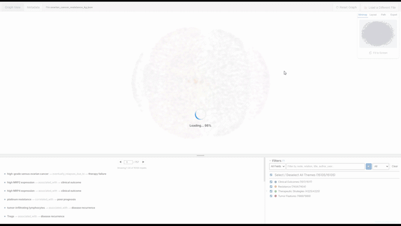
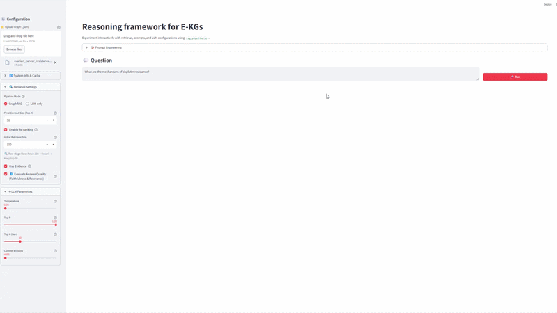

# Ovarian Cancer Resistance Knowledge Graph

This repository presents an evidence-based knowledge graph (KG) framework for studying resistance mechanisms in ovarian cancer. It integrates information extraction from scientific literature with large language models (LLMs), combined with human-in-the-loop (HITL) validation, enabling the construction, enrichment, and exploration of structured biomedical knowledge.

## 📋 Table of Contents

-   [Key Features](#-key-features)
-   [Project Architecture](#-project-architecture)
-   [Prerequisites](#-prerequisites)
-   [Installation](#-installation)
-   [Usage and Execution](#-usage-and-execution)
-   [Article Builder Module](#-article-builder-module)
-   [Abstract Augmenter Module](#-abstract-augmenter-module)
-   [Interactive Visualization](#-interactive-visualization)
-   [Reasoning Framework](#-reasoning-framework)
-   [Experiments & Analysis Module](#-experiments--analysis-module)
- [Citation](#-citation)
- [License](#-license)


---

## 🚀 Key Features

* **Evidence-based KG Construction**: Builds a graph grounded in scientific literature, where each extracted relation is linked to its original source (DOI, page, and textual evidence), ensuring traceability and interpretability.

* **LLM-based Information Extraction**: Leverages LLMs to identify and extract structured relations (subject–predicate–object) from full-text articles and abstracts.

* **Human-in-the-Loop (HITL) Validation**: Integrates expert feedback into the graph construction pipeline through iterative refinement of extraction, structuring, and normalization, improving quality and reliability.

* **Normalization and Refinement**: Combines embedding-based clustering, LLM-assisted disambiguation, and expert-defined constraints to ensure consistent and semantically coherent graph representations.

* **Interactive Graph Exploration**: Provides a web-based interface for exploring the KG, including filtering, community detection, and path-based analysis.

* **Reasoning Framework**: Enables natural language querying over the E-KG, supporting evidence-grounded reasoning and knowledge discovery.

---

## 📂 Project Architecture

```text
ovarian_cancer_resistance_kg/
├── data/                  # Project data storage
│   ├── raw/               # Raw input data (PDFs and scraped abstracts)
│   └── releases/          # Versioned KG releases
├── src/                   # Main project source code
│   ├── article_builder/       # KG construction module from PDFs
│   ├── abstract_augmenter/    # KG enrichment module using PubMed abstracts
│   ├── experiments/           # Analysis and evaluation module
│   ├── visualization/         # Interactive web interface for KG exploration
│   ├── graph_rag/             # Streamlit-based QA system over the KG
│   └── utils/                 # I/O utilities, LLM interfaces, logging, constants
├── config/                # Configuration files for all modules
├── prompts/               # LLM prompt templates
├── assets/                # Documentation assets (GIFs)
├── requirements.txt       # Python dependencies
├── LICENSE                # MIT license
└── README.md              # Project documentation
```

---

## ✅ Prerequisites

Ensure that Python (3.9 or higher) and Git are installed.

### Requirement: Ollama

This project uses **Ollama** for local LLM inference. Install it from https://ollama.ai and make sure the service is running before execution.

We recommend using the MedGemma model (https://ollama.com/alibayram/medgemma).
The MedGemma 27B model may require significant GPU resources (≈12–24GB of GPU VRAM depending on quantization). However, it can also run on CPU using quantization with reduced performance.

#### Model setup — pull the MedGemma model:

```bash
ollama pull alibayram/medgemma:27b
```

#### Start service — run Ollama service in the background:

```bash
ollama serve
```

---

## ⚙️ Installation

1.  **Clone the repository**
    ```bash
    git clone https://github.com/hjthomp/ovarian-cancer-resistance-kg.git
    cd ovarian_cancer_resistance_kg
    ```

2.  **Create a virtual environment**

    ```bash
    python -m venv venv
    ```

3.  **Activate the environment**

    **Windows:**
    ```bash
    .\venv\Scripts\activate
    ```

    **Mac/Linux:**
    ```bash
    source venv/bin/activate
    ```

4.  **Install dependencies**

    ```bash
    pip install -r requirements.txt
    ```

---

## ▶️ Usage and Execution

Activate the virtual environment and ensure Ollama is running, then start the main menu:

```bash
python -m src.main
```
This will open the interactive interface:

```
============================================================
 OVARIAN CANCER KNOWLEDGE GRAPH 
============================================================
  [1] Article Builder (PDFs -> Graph)
  [2] Abstract Augmenter (PubMed -> Augmentation)
  [3] Release Manager (Publish to 'data/releases')
  [4] Experiments & Analysis
  [5] Interactive Visualization (Web)
  [6] Reasoning Framework (Streamlit)
  ---
  [Q] Exit Application
============================================================
```

Select the corresponding option to execute each module.

---

## 🧩 Article Builder Module

This module (`src/article_builder`) constructs the initial KG from full-text PDF articles, extracting structured relations from scientific literature and integrating them into the graph. It is configured via `config/article_builder/` and uses data stored under `data/raw/articles`.

Select option `[1] Article Builder (PDFs -> Graph)` from the main menu.

```text
===================== MODULE: BUILD_GRAPH ======================
      Articles are loaded from 'config/articles.yaml'

  [1] Create a graph from all articles
  [2] Create a graph from an article
  [3] Unify processed graphs
  [4] Resume interrupted run
  ---
  [R] Return to principal menu
  [Q] Exit
============================================================
```

---

## 🔄 Abstract Augmenter Module

This module (`src/abstract_augmenter`) extends the KG by retrieving, processing, and normalizing related abstracts from PubMed. It is configured via the `config/abstract_augmenter/` directory and uses existing graphs as input for further enrichment.

Select option `[2] Abstract Augmenter (PubMed -> Augmentation)` from the main menu.

```text
====================== MODULE: AUGMENT_GRAPH =======================
  PubMed Augmentation Runs
  [1] Start new run from Article Graph
  [2] Start new run from Augmented Graph
  [3] Resume an incomplete run
  [4] Generate a partial graph from an incomplete run
  ---
  Single-Article Augmentation
  [5] Add a single abstract from Article Graph
  [6] Add a single abstract from Augmented Graph
  ---
  Post-processing (only for complete runs)
  [7] Normalize an Augmented Graph
  [8] Refine a Graph
  ---
  [R] Return to principal menu
  [Q] Exit
====================================================================
```

---

## 🌐 Interactive Visualization

This module (`src/visualization`) provides an interactive web interface to explore the generated KG. It runs in the browser and loads data directly from JSON files, without requiring a backend server.

Select option `[5] Interactive Visualization (Web)` from the main menu, or open `visualization/index.html` directly in your browser. Graphs can be loaded from `data/releases/`.



---

## 🤖 Reasoning Framework

This module (`src/graph_rag`) provides an interactive Streamlit-based interface for natural language querying of the KG, enabling evidence-grounded question answering and reasoning over biomedical data.

Select option `[6] Reasoning Framework (Streamlit)` from the main menu, or run the Streamlit app (`streamlit run src/graph_rag/app.py`). Ensure that Ollama is running before launching the application.



---

## 🔬 Experiments & Analysis Module

This module (`src/experiments`) provides tools for evaluating and analyzing the constructed KG, including experimental pipelines and analysis utilities.

Select option `[4] Experiments & Analysis` from the main menu.

```
============================================================
 MODULE: EXPERIMENTS 
============================================================
  [1] Calculate Statistics
  [2] Expert Evaluation: Generate Splits
  [3] Expert Evaluation: Calculate Metrics (requires manually annotated data)
  [4] Link Prediction Evaluation
  [5] NER Pipeline (Extraction & Normalization)
  [6] Plot NER Results
  [7] Plot WordClouds
  ---
  [R] Return to principal menu
  [Q] Exit Application
============================================================
```

---

## 📖 Citation

If you find this work useful, please cite:

```bibtex
@article{thompson2026ekg,
  title={An Evidence-Based Knowledge Graph Framework with Large Language Models and Human-in-the-Loop for Ovarian Cancer Resistance},
  author={Thompson, Horacio and Conforti, Rocío A. and Andujar, Sebastián A. and Casais, Marilina and Telleria, Carlos M. and Errecalde, Marcelo},
  journal={Submitted to MDPI},
  year={2026}
}
```

## 📬 Contact
[hjthompson@unsl.edu.ar](mailto:hjthompson@unsl.edu.ar)

## 📄 License

This project is licensed under the MIT License. See the `LICENSE` file for details.
